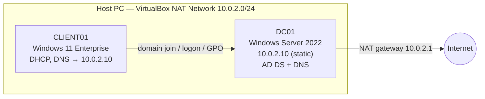

# Active Directory Home Lab

A small Windows domain built from scratch in VirtualBox, used to practice everyday **IT help desk and system administration** tasks: building a domain controller, joining a workstation, organizing users with OUs and groups, unlocking accounts, resetting passwords, offboarding, and pushing out Group Policy.

Every step was done both in the GUI (Server Manager, ADUC, GPMC) and with the **PowerShell scripts** in [`/scripts`](scripts), so the whole build can be repeated.

---

## Lab Architecture



| Item | Value |
|---|---|
| Domain | `homelab.local` (NetBIOS `HOMELAB`) |
| Domain controller | `DC01` — Windows Server 2022 (Desktop Experience), 2 vCPU / 4 GB RAM |
| Client | `CLIENT01` — Windows 11 Enterprise eval, 2 vCPU / 4 GB RAM |
| Network | VirtualBox NAT Network, DC on static `10.0.2.10` |

## Skills Demonstrated

- Installing **AD DS** and **DNS**, promoting a server to a domain controller
- Static IP / DNS configuration and troubleshooting domain join
- Designing an **OU structure** and **security groups** (role-based access)
- Bulk user provisioning from CSV with PowerShell
- **Account lockout**, unlocking, and **password resets** — the most common tier-1 tickets
- User **offboarding** (disable, remove groups, move to Disabled OU)
- Creating, linking and scoping **Group Policy Objects**, verifying with `gpresult`
- **Least-privilege delegation** — help desk can reset passwords without being Domain Admins

## OU & Group Design

```
homelab.local
└── _HOMELAB
    ├── Users
    │   ├── IT          (aturner, jreyes, tbrooks)
    │   ├── HR          (mhayes, cnguyen, rpatel)
    │   ├── Finance     (jokafor, acollins, qramirez)
    │   └── Sales       (dsullivan, pkim, rmitchell)
    ├── Groups          (GG_IT, GG_HR, GG_Finance, GG_Sales, GG_Helpdesk)
    ├── Workstations    (CLIENT01)
    ├── Servers
    ├── Service Accounts
    └── Disabled Users
```

## Group Policy

| GPO | Linked to | What it does |
|---|---|---|
| Default Domain Policy (edited) | Domain | Lock account after 5 bad passwords for 15 min |
| `USR - Screen Lock 10 Min` | `Users` | Password-protected screen lock after 10 min idle |
| `USR - Block Control Panel` | `Users\Sales` only | Removes Control Panel / Settings for Sales — shows GPO scoping |
| `CMP - Logon Legal Banner` | `Workstations` | Authorized-use warning before sign-in (compliance control) |

---

## Build Steps

| # | Where | Script | What happens |
|---|---|---|---|
| 0 | Host | — | Install VirtualBox, download eval ISOs, create NAT Network `ADLab` (10.0.2.0/24), build both VMs |
| 1 | DC | [`01-Configure-DCNetwork.ps1`](scripts/01-Configure-DCNetwork.ps1) | Static IP, DNS, rename to DC01 |
| 2 | DC | [`02-Install-ADDS.ps1`](scripts/02-Install-ADDS.ps1) | Install AD DS + DNS, create `homelab.local` forest |
| 3 | DC | [`03-Create-OUs.ps1`](scripts/03-Create-OUs.ps1) | Build OU structure |
| 4 | DC | [`04-Create-Groups.ps1`](scripts/04-Create-Groups.ps1) | Create security groups |
| 5 | DC | [`05-Create-Users.ps1`](scripts/05-Create-Users.ps1) + [`users.csv`](scripts/users.csv) | Bulk-create 12 users, add to groups |
| 6 | Client | [`06-Join-Domain.ps1`](scripts/06-Join-Domain.ps1) | Point DNS at DC, join domain into Workstations OU |
| 7 | DC | [`07-Configure-GroupPolicy.ps1`](scripts/07-Configure-GroupPolicy.ps1) | Lockout policy + 3 GPOs |
| 8 | DC | [`08-Delegate-Helpdesk.ps1`](scripts/08-Delegate-Helpdesk.ps1) | Delegate reset/unlock to GG_Helpdesk |
| — | DC | [`HelpdeskTools.ps1`](scripts/HelpdeskTools.ps1) | Unlock / reset / status / offboard functions with action log |

Full walkthrough with GUI steps: **[docs/lab-guide.md](docs/lab-guide.md)**
Ticket-style practice scenarios: **[docs/helpdesk-tickets.md](docs/helpdesk-tickets.md)**

---

## Screenshots

> Screenshots live in [`/screenshots`](screenshots). Each one is added as the step is completed.

| Step | Screenshot |
|---|---|
| DC promoted — Server Manager showing AD DS & DNS | `screenshots/01-server-manager.png` |
| OU / user structure in ADUC | `screenshots/02-aduc-ous.png` |
| CLIENT01 joined — System properties showing domain | `screenshots/03-domain-joined.png` |
| Locked-out user and unlock | `screenshots/04-unlock.png` |
| Password reset with "must change at next logon" | `screenshots/05-password-reset.png` |
| GPMC showing linked GPOs | `screenshots/06-gpmc.png` |
| `gpresult /r` on CLIENT01 | `screenshots/07-gpresult.png` |
| Logon banner on CLIENT01 | `screenshots/08-logon-banner.png` |

## What I Learned

<!-- Fill this in after finishing the lab — real problems you hit are the best part for interviews -->
- 
- 
- 

## Troubleshooting Notes

| Problem | Cause | Fix |
|---|---|---|
| "An Active Directory Domain Controller for the domain could not be contacted" when joining | Client DNS pointed at the router, not the DC | Set client DNS to `10.0.2.10`, `ipconfig /flushdns`, `nslookup homelab.local` |
| No "Domain" option in System Properties | Windows **Home** edition | Use Pro / Enterprise / Education |
| Users never lock out | New domains have lockout threshold = 0 | Set threshold in Default Domain Policy (step 7) |
| GPO not applying | Object is in the wrong OU, or policy hasn't refreshed | Check OU in ADUC, run `gpupdate /force`, read `gpresult /r` |
