# Active Directory Home Lab

A small Windows domain built from scratch in VirtualBox, used to practice everyday **IT help desk and system administration** tasks: building a domain controller, joining a workstation, organizing users with OUs and groups, unlocking accounts, resetting passwords, offboarding, and pushing out Group Policy.

> **Project summary:** I built a small Windows domain at home — a Windows Server 2022 domain controller and a Windows 11 client. I set up OUs, security groups and 12 users with PowerShell (plus 1 more onboarded through a new-hire ticket), applied Group Policies scoped to specific departments, and worked through real help desk tickets: lockouts, password resets, onboarding and offboarding. I also delegated just enough rights for a help desk group to do resets without being admins.

The build is automated with the **PowerShell scripts** in [`/scripts`](scripts) so it can be repeated, and the results were checked in the GUI tools (Server Manager, ADUC, GPMC) — see the [screenshots](#screenshots).

---

## Lab Architecture

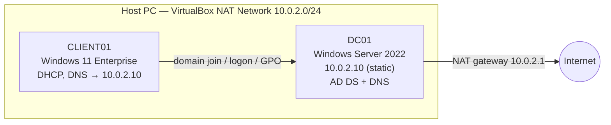

| Item | Value |
|---|---|
| Domain | `homelab.local` (NetBIOS `HOMELAB`) |
| Domain controller | `DC01` — Windows Server 2022 Standard Eval (Desktop Experience), 2 vCPU / 3 GB RAM / 50 GB disk |
| Client | `CLIENT01` — Windows 11 Enterprise Eval (TPM 2.0 + Secure Boot), 2 vCPU / 4 GB RAM / 80 GB disk |
| Network | VirtualBox NAT Network `ADLab`, DC on static `10.0.2.10` |
| Host | Windows PC, 16 GB RAM, 6-core CPU, VirtualBox 7.2 |

## Skills Demonstrated

- Installing **AD DS** and **DNS**, promoting a server to a domain controller
- Static IP / DNS configuration and troubleshooting domain join
- Designing an **OU structure** and **security groups** (role-based access)
- Bulk user provisioning from CSV with PowerShell
- **Account lockout**, unlocking, and **password resets** — the most common tier-1 tickets
- User **offboarding** (disable, remove groups, move to Disabled OU)
- Creating, linking and scoping **Group Policy Objects**, verifying with `gpresult`
- **Least-privilege delegation** — help desk can reset passwords without being Domain Admins

## OU & Group Design

```
homelab.local
└── _HOMELAB
    ├── Users
    │   ├── IT          (aturner, jreyes, tbrooks)
    │   ├── HR          (mhayes, cnguyen, rpatel)
    │   ├── Finance     (jokafor, acollins, qramirez)
    │   └── Sales       (dsullivan, pkim, rmitchell)
    ├── Groups          (GG_IT, GG_HR, GG_Finance, GG_Sales, GG_Helpdesk)
    ├── Workstations    (CLIENT01)
    ├── Servers
    ├── Service Accounts
    └── Disabled Users
```

## Group Policy

| GPO | Linked to | What it does |
|---|---|---|
| Default Domain Policy (edited) | Domain | Lock account after 5 bad passwords for 15 min |
| `USR - Screen Lock 10 Min` | `Users` | Password-protected screen lock after 10 min idle |
| `USR - Block Control Panel` | `Users\Sales` only | Removes Control Panel / Settings for Sales — shows GPO scoping |
| `CMP - Logon Legal Banner` | `Workstations` | Authorized-use warning before sign-in (compliance control) |

---

## Build Steps

| # | Where | Script | What happens |
|---|---|---|---|
| 0 | Host | — | Install VirtualBox, download eval ISOs, create NAT Network `ADLab` (10.0.2.0/24), build both VMs |
| 1 | DC | [`01-Configure-DCNetwork.ps1`](scripts/01-Configure-DCNetwork.ps1) | Static IP, DNS, rename to DC01 |
| 2 | DC | [`02-Install-ADDS.ps1`](scripts/02-Install-ADDS.ps1) | Install AD DS + DNS, create `homelab.local` forest |
| 3 | DC | [`03-Create-OUs.ps1`](scripts/03-Create-OUs.ps1) | Build OU structure |
| 4 | DC | [`04-Create-Groups.ps1`](scripts/04-Create-Groups.ps1) | Create security groups |
| 5 | DC | [`05-Create-Users.ps1`](scripts/05-Create-Users.ps1) + [`users.csv`](scripts/users.csv) | Bulk-create 12 users, add to groups |
| 6 | Client | [`06-Join-Domain.ps1`](scripts/06-Join-Domain.ps1) | Point DNS at DC, join domain into Workstations OU |
| 7 | DC | [`07-Configure-GroupPolicy.ps1`](scripts/07-Configure-GroupPolicy.ps1) | Lockout policy + 3 GPOs |
| 8 | DC | [`08-Delegate-Helpdesk.ps1`](scripts/08-Delegate-Helpdesk.ps1) | Delegate reset/unlock to GG_Helpdesk |
| — | DC | [`HelpdeskTools.ps1`](scripts/HelpdeskTools.ps1) | Unlock / reset / status / offboard functions with action log |

Full walkthrough with GUI steps: **[docs/lab-guide.md](docs/lab-guide.md)**
Ticket-style practice scenarios: **[docs/helpdesk-tickets.md](docs/helpdesk-tickets.md)**

---

## Screenshots

### Domain controller
**DC01 promoted — Server Manager showing the AD DS and DNS roles**
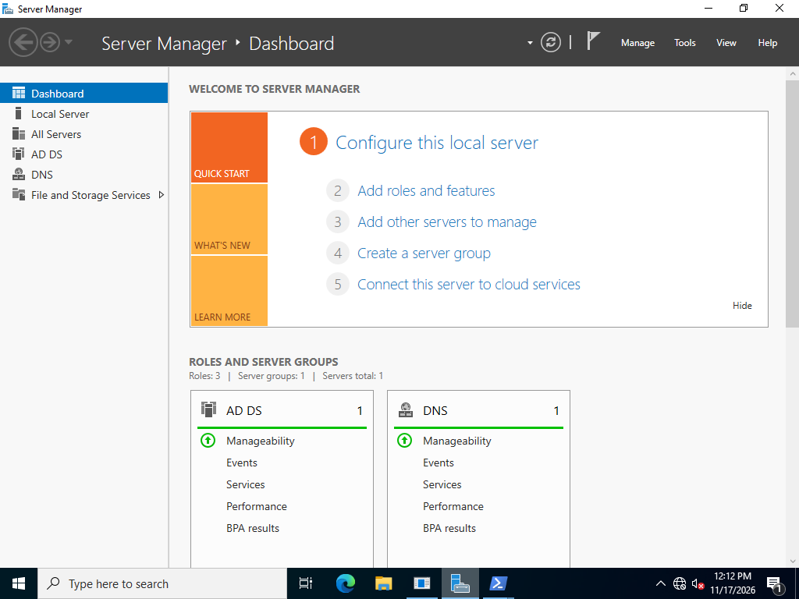

**OU structure in Active Directory Users and Computers (IT OU selected)**
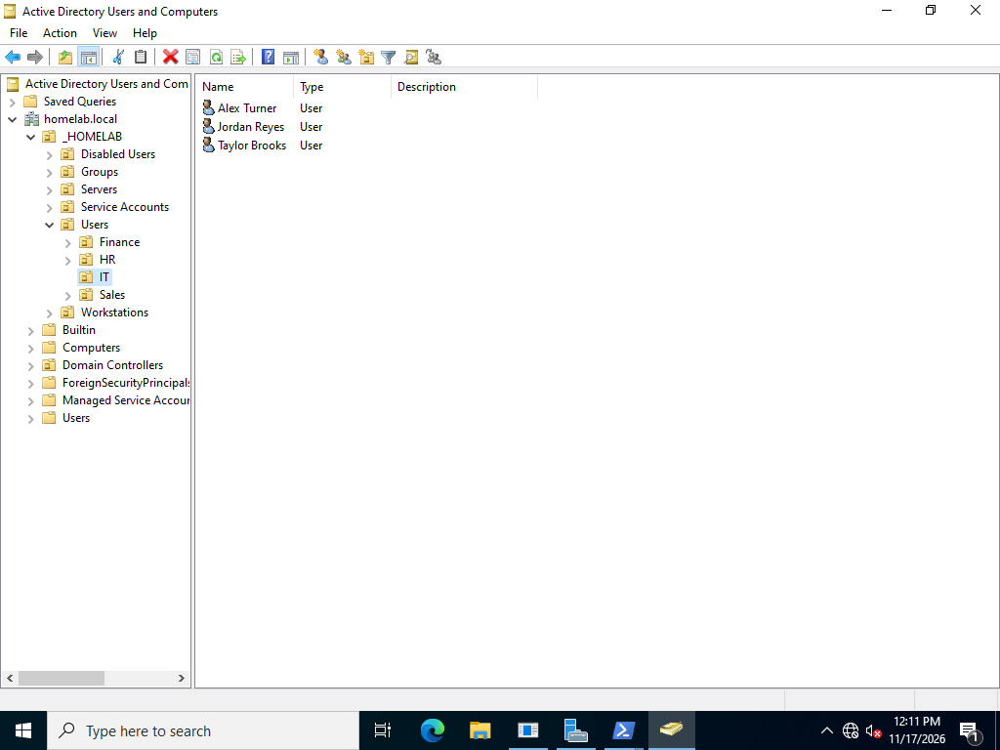

**CLIENT01 placed in the Workstations OU at join time**
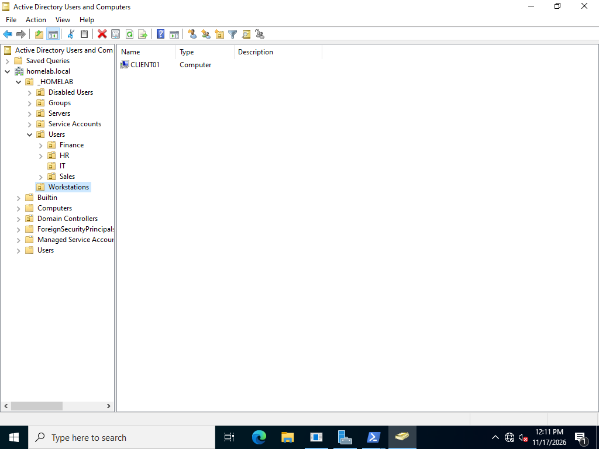

**Group Policy Objects in GPMC**
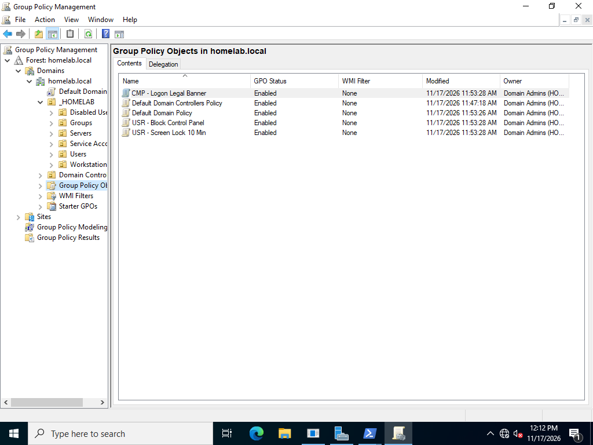

### Client
**CLIENT01 joined to `homelab.local`, signed in as `homelab\pkim`, DC located with `nltest`**
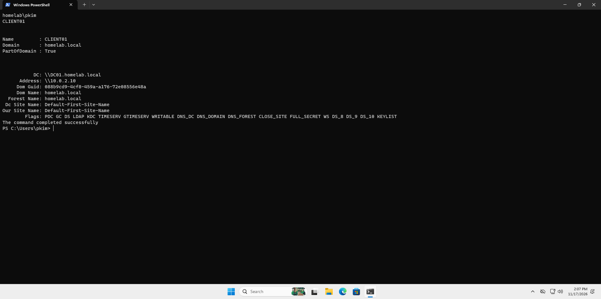

**Computer GPO: authorized-use banner before sign-in**
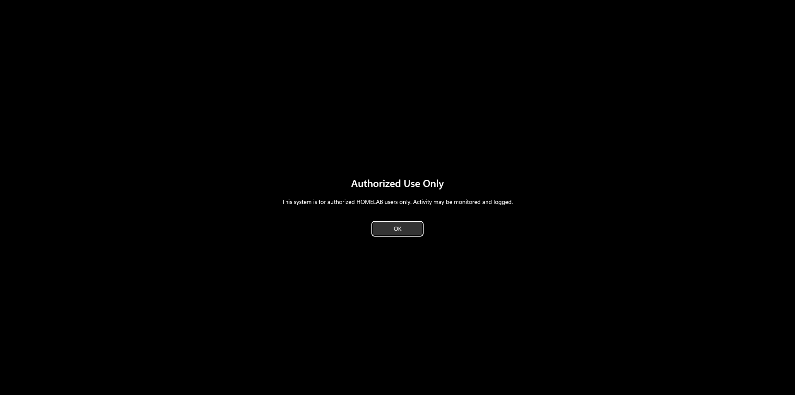

**`gpresult /r` as a Sales user — both user GPOs applied from DC01, member of GG_Sales**
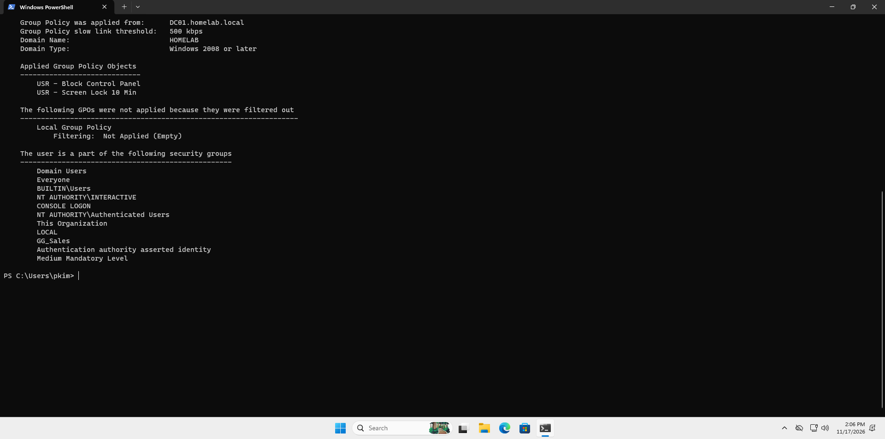

**Sales-scoped GPO in action — Control Panel blocked for `pkim`**
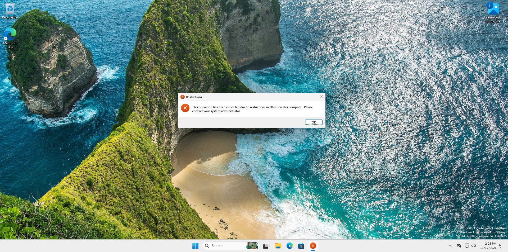

### Help desk tickets
**TKT-1001 — account locked after 5 bad passwords, found and unlocked**
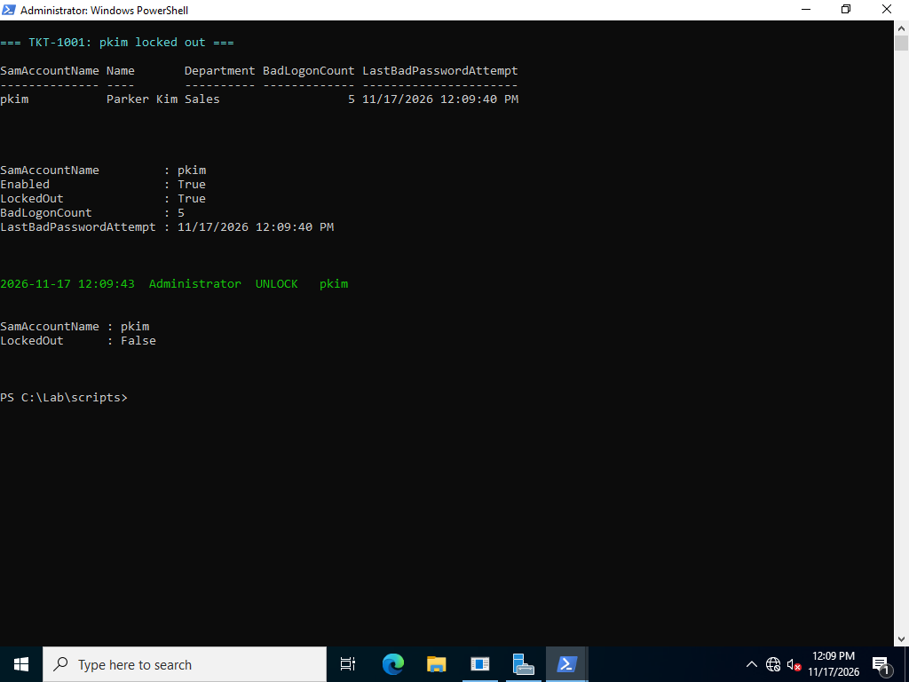

**TKT-1002 / TKT-1004 — password reset (must change at next logon) and new-hire account for Sam Lee**
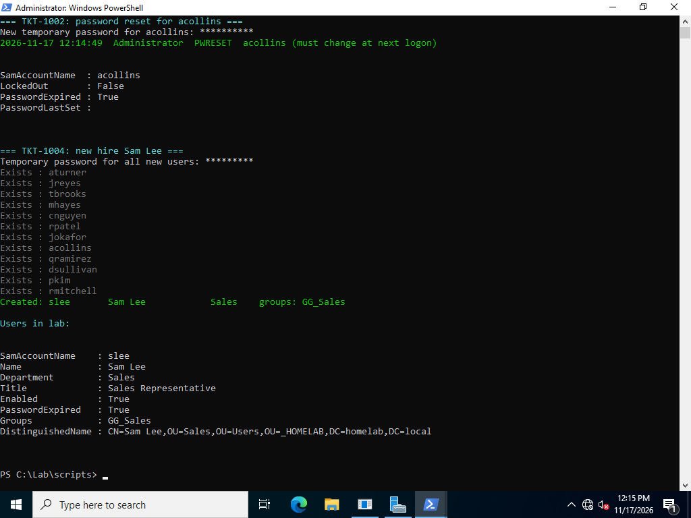

**TKT-1005 — offboarding: disabled, groups removed, moved to Disabled Users**
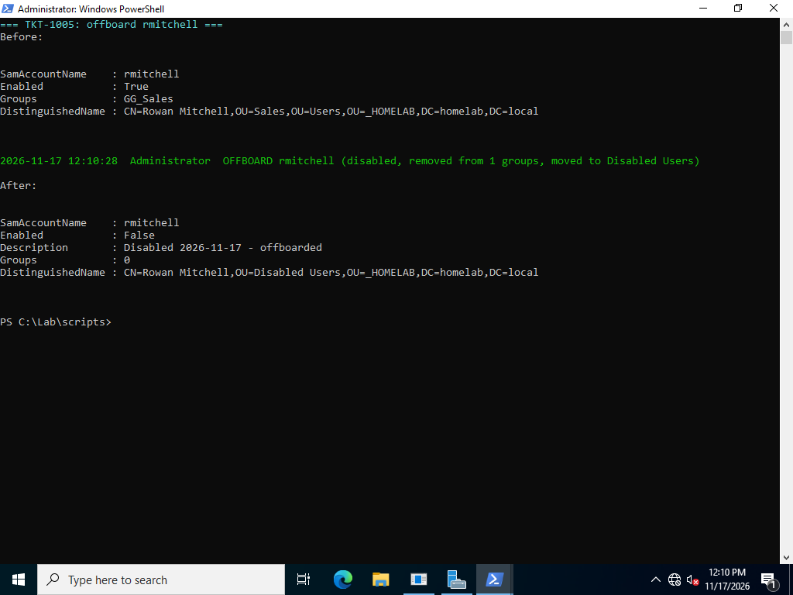

## What I Learned

- **Virtualization:** I built two computers inside my PC with VirtualBox — a Windows Server 2022 domain controller and a Windows 11 workstation — on their own private network. That meant planning RAM, CPU and disk for each one, because both VMs share my PC's 16 GB.
- **DNS is the foundation of Active Directory:** the domain controller needs a static IP, and every computer joining the domain has to use the DC for DNS. If DNS is wrong, the domain join fails — it's the first thing I'd check on any "can't reach the domain" ticket.
- **OUs vs. groups:** OUs organize accounts and are where Group Policy gets applied. Security groups are how permissions get granted. Giving access to a group like `GG_Sales` instead of to individual users means someone changing departments is a quick group swap.
- **Group Policy scoping:** where a GPO is linked decides who gets it. My "Block Control Panel" policy only hit Sales users while IT users weren't affected, and `gpresult /r` shows exactly which policies applied to a user and why.
- **Least privilege:** help desk staff don't need to be Domain Admins. I gave the help desk group only the rights to reset passwords and unlock accounts, and only on the Users OU.
- **Secure defaults aren't automatic:** a brand-new domain has no account lockout policy, so accounts never lock no matter how many wrong passwords are tried. I set it to lock after 5 attempts for 15 minutes.
- **Real help desk habits:** verify the caller's identity before resetting a password, force a password change at next sign-in, disable departed users instead of deleting them and remove their group access, and log every action like a ticket.
- **PowerShell saves time:** the GUI is good for one-off fixes, but scripting created 12 users, 5 groups and 11 OUs the same way every time, and the build can be repeated.
- **Troubleshooting is part of the job:** VirtualBox's automatic install failed on the Server trial ISO, a VM's screen froze after a driver install, and a stale DHCP lease cut off the network. Each time I read the error, isolated the cause, fixed it, and documented it in the table below.

## Troubleshooting Notes

| Problem | Cause | Fix |
|---|---|---|
| "An Active Directory Domain Controller for the domain could not be contacted" when joining | Client DNS pointed at the router, not the DC | Set client DNS to `10.0.2.10`, `ipconfig /flushdns`, `nslookup homelab.local` |
| No "Domain" option in System Properties | Windows **Home** edition | Use Pro / Enterprise / Education |
| Users never lock out | New domains have lockout threshold = 0 | Set threshold in Default Domain Policy (step 7) |
| GPO not applying | Object is in the wrong OU, or policy hasn't refreshed | Check OU in ADUC, run `gpupdate /force`, read `gpresult /r` |
| Windows Setup: "Windows cannot find the Microsoft Software License Terms" | VirtualBox *unattended install* bug with the Server 2022 **evaluation** ISO | Mounted the ISO directly and did a normal (attended) install instead |
| Typing into the PowerShell console did nothing | Clicking inside the legacy console window enters **QuickEdit/Select** mode, which swallows keystrokes (title bar shows "Select") | Press `Esc` or click the title bar instead of the console body |
| DC01 screen froze after installing Guest Additions | New display driver loaded without a reboot | Rebooted the VM |
| DC01 had no network after moving its adapter to the NAT Network while running | Stale DHCP lease from the previous adapter attachment | Reboot renewed the lease; gateway `10.0.2.1` then answered |
| VMs sluggish, dropped keystrokes | Both VMs (7 GB) plus host apps on a 16 GB host | Closed host apps; DC01 sized at 3 GB |
